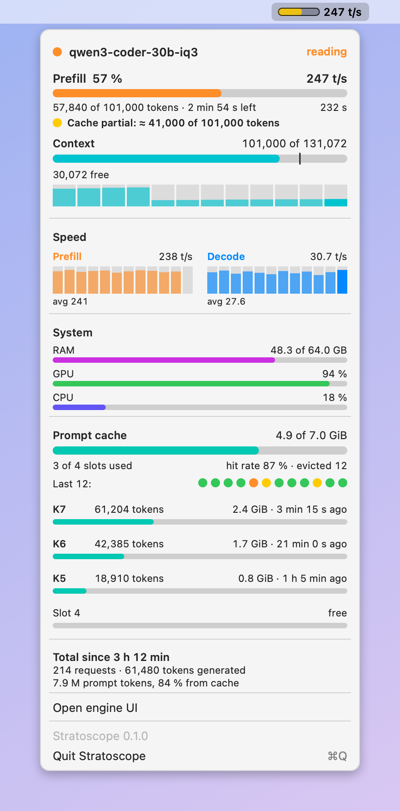
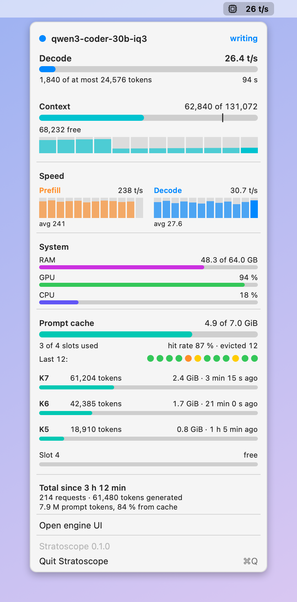

<div align="center">

# Stratoscope

A speedometer for your local LLM, always visible in your menu bar.

[](https://github.com/yosephyne/stratoscope/releases/latest)

[](LICENSE)


<br>

<picture>
  <source media="(prefers-color-scheme: dark)" srcset="docs/img/menu-dark.png">
  
</picture>

</div>

<br>

Stratoscope sits in the menu bar and shows what your local LLM inference engine is doing right now.

- The speed, like `247 t/s`. While the prompt is being read it's the prefill speed, while the answer is being written it's the decode speed.
- A progress bar next to it while the prompt is read. Its color tells you how much came from the cache.
- In the menu: the current request, how full the context is and how its size changed over the last 12 requests, the speed of the last 12 requests, RAM / GPU / CPU, the cache slots, and totals.

When no local LLM inference engine is running, the menu bar item disappears.

**Cache colors**

| Color | Meaning |
|---|---|
| Green | 90 % or more of the prompt came from the cache |
| Yellow | Less than 90 %, but at least 8,192 tokens were reused |
| Orange | Less than 8,192 tokens reused. Expect a wait |
| Gray | Prompt under 4,096 tokens. Too small to matter |

<table>
  <tr>
    <td align="center"><br><sub>Reading the prompt</sub></td>
    <td align="center"><br><sub>Writing the answer</sub></td>
  </tr>
</table>

## Install

### macOS

1. Download the latest `Stratoscope-<version>.dmg` from [Releases](https://github.com/yosephyne/stratoscope/releases/latest).
2. Open it and drag Stratoscope to Applications.
3. Start it. On the first launch macOS warns you, because the app isn't notarized yet. Open System Settings → Privacy & Security, scroll down and click **Open Anyway**.

To start it at login: System Settings → General → Login Items → add Stratoscope.

Built for macOS 13 or newer, Apple Silicon and Intel. Tested so far on Apple Silicon with macOS 27.

### Other platforms

| Platform | Status |
|---|---|
| macOS | Works |
| Windows | Planned |
| Linux | Not yet |

The inference engine adapters and all the numbers are platform-neutral. Only the menu bar part is macOS code, so another platform needs its own small front end: [docs/ARCHITECTURE.md](docs/ARCHITECTURE.md#platforms).

## Supported inference engines

| Inference engine | Status |
|---|---|
| Strata | Works |
| Demo (fake data, to try the menu without an inference engine) | Works: `STRATOSCOPE_ENGINE=demo` |
| llama.cpp, MLX, Uzu, BaseRT | Not yet |

Each inference engine has a small adapter that turns its metrics into one common format. The menu only knows that format. If your inference engine exposes metrics over HTTP, writing an adapter is usually one file. See [docs/ARCHITECTURE.md](docs/ARCHITECTURE.md), or open an "Engine request" issue.

### Strata

Stratoscope reads `http://127.0.0.1:8095/metrics` by default. For the list of parked conversations it also reads Strata's log file. If you run a llama-swap router in front of Strata, set `router` and Stratoscope takes the model name and loading state from there.

Nothing is sent anywhere except requests to your Strata server. It never writes to Strata or its files. When Strata doesn't report a value, the menu shows `–` instead of guessing, and an estimated number gets a `≈`.

## Settings

Environment variables win over `~/.config/stratoscope.json`, which wins over the defaults. If you start the app from the Finder on macOS, use the JSON file, because the Finder doesn't pass your shell variables on.

| Variable | JSON key | Does |
|---|---|---|
| `STRATOSCOPE_ENGINE` | `engine` | Which inference engine to read: `strata` (default) or `demo` |
| `STRATOSCOPE_URL` | `url` | Inference engine address. Strata default: `http://127.0.0.1:8095` |
| `STRATOSCOPE_ROUTER_URL` | `router` | Router in front of the inference engine. `none` turns it off |
| `STRATOSCOPE_LOG` | `log` | Inference engine log file. Strata default: newest `*.log` in `~/.local/share/strata/install` |
| `STRATOSCOPE_WEBUI_URL` | `webui` | Adds an "Open chat UI" entry to the menu |
| `STRATOSCOPE_COMPACT_AT` | `compact_at` | Optional. Token count where your client summarises the chat. Drawn as a line on the context bar. Without it there is no line |

Example `~/.config/stratoscope.json`:

```json
{ "url": "http://127.0.0.1:8095", "webui": "http://127.0.0.1:3000", "compact_at": 60000 }
```

## Build from source

On macOS you need the Xcode Command Line Tools (`xcode-select --install`).

```bash
git clone https://github.com/yosephyne/stratoscope.git
cd stratoscope
./scripts/build-app.sh --install    # builds and copies to /Applications
```

While working on it:

```bash
swift build                                     # build
./scripts/test.sh                               # tests
STRATOSCOPE_ENGINE=demo swift run Stratoscope   # run with fake data
./scripts/screenshot.sh                         # redo the images above (after any change to how the menu looks)
./scripts/make-dmg.sh                           # build the DMG that goes on Releases
```

Pull requests are welcome, adapters most of all. Read [CONTRIBUTING.md](CONTRIBUTING.md) first, it's short.

## License

[MIT](LICENSE)
