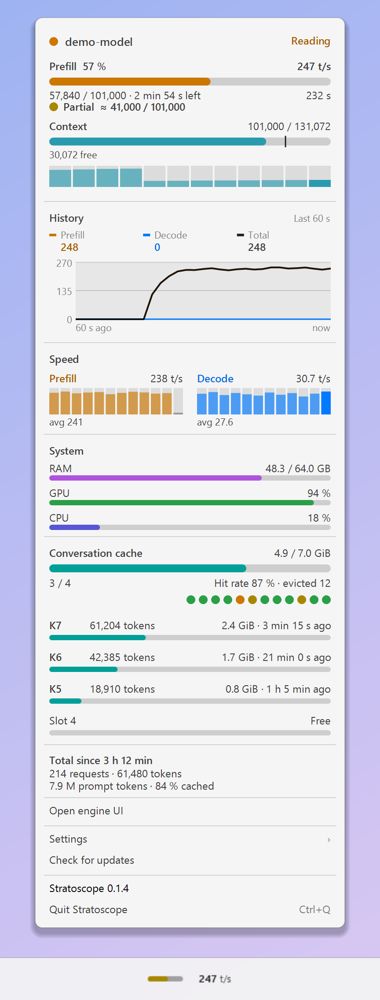
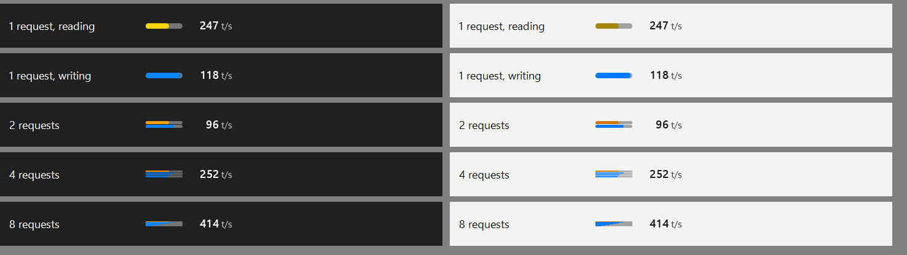
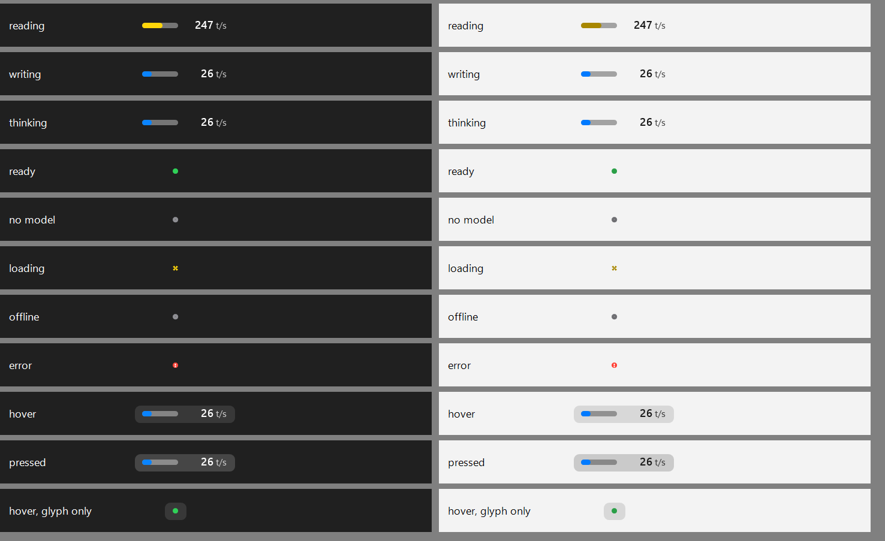

# Stratoscope on Windows

A readout in the taskbar with the live speed, and the same panel as the Mac menu. Windows 10 (1809 or newer) and 11, x64. Tried so far on Windows 11 24H2 only.

<div align="center">
<picture>
  <source media="(prefers-color-scheme: dark)" srcset="img/windows-panel-dark.png">
  
</picture>
</div>

## Install

1. Download `Stratoscope-<version>-windows-setup.exe` from [Releases](https://github.com/yosephyne/stratoscope/releases/latest) and open it.
2. Look at the taskbar: the readout appears next to the notification area.

No administrator rights. It installs into `%LOCALAPPDATA%\Stratoscope`, starts with Windows, and is not code-signed, so SmartScreen may warn once.

- Update: run the Setup again. Settings stay.
- Remove: Settings > Apps, or `uninstall.ps1` (`-RemoveSettings` also deletes `config.json`).
- Silent: `Stratoscope-<version>-windows-setup.exe /VERYSILENT`.
- Already have the .NET 10 Desktop Runtime? Take `-windows-framework-dependent.zip` (0.3 MB).
- The zips hold `install.cmd` and `install.ps1` (options: `-Autostart default|yes|no`, `-DesktopIcon`, `-NoStart`, `-InstallDirectory`).

## What you see

- **Readout**, one item per server: a glyph and the speed (`[bar] 247 t/s`, `[dot] 26 t/s`). While nothing runs, only the glyph.
- **Glyph**: one bar per running request, up to eight, each as wide as the single bar and packed into the height of one: a request that reads shows its prompt progress (colored by how much came from the cache while it is the only request, orange with several), one that writes shows its own speed in blue against a scale that adapts to what runs (rises with a margin, steps back after 25 s below half). Green dot when ready; grey ring when offline or no model; dotted ring while loading; red mark on an error.
- **Custom engine**: reading and writing per request from its `/ui/state` while requests run; without it, one busy state ("running") and no speed.
- **Speed**: plain digits, `10k` from 9,999.5 t/s. With parallel requests it is the total.


- **Position**: centred in the free gap of the taskbar. It moves only when the taskbar geometry changes, then once.
- **Panel**: the Mac menu, with tabs for several servers. Below the live block a graph shows the last 60 seconds: orange prefill speed, blue decode speed, black total throughput (prompt plus generated tokens per second), with the current value of each and an axis from 0 to the adaptive maximum. Two or more parallel requests show a sum bar with one smaller bar per request.
- **Tooltips**: only data the element does not show. Nothing to add, no tooltip.
- **Keys**: Esc closes, Left and Right switch tabs, Ctrl+Q quits.


## Settings

Open `%LOCALAPPDATA%\Stratoscope\config.json` from the menu (Settings > Open settings file). It reloads when saved. Environment variables win over the file.

| Variable | Key | Does |
|---|---|---|
| `STRATOSCOPE_ENGINE` | `engine` | `strata` (default: asks the engine whether it is a Strata, a Basalt, a llama.cpp or a custom 27B server), `basalt` (Basalt only), `llamacpp` (llama-server only), `custom` (custom 27B server only) or `demo` |
| `STRATOSCOPE_URL` | `url` | engine address, default `http://127.0.0.1:8095` |
| `STRATOSCOPE_ROUTER_URL` | `router` | router in front of the engine, `none` turns it off |
| `STRATOSCOPE_LOG` | `log` | engine log file; no default on Windows |
| `STRATOSCOPE_WEBUI_URL` | `webui` | adds "Open chat UI" |
| `STRATOSCOPE_COMPACT_AT` | `compact_at` | token count of the tick on the context bar, used when no client config says |
| `STRATOSCOPE_CLIENT_MODEL` | `client_model` | model id your client config uses, if it differs from the one the engine reports |
| `STRATOSCOPE_CLIENT_CONFIGS` | `client_configs` | `none` stops reading client configs |
| | `servers` | list of `{ name, engine, url, router, log, webui, client_model }` |
| `STRATOSCOPE_READOUT_POSITION` | `readout_position` | `center` (default), `tray`, `after-buttons`, `left` |
| `STRATOSCOPE_HISTORY_SMOOTHING` | `history_smoothing` | `off`, `normal` (default), `high` or `highest`: the smoothing of the history graph (damping 0, 0.5, 0.9, 0.95); also in the panel under Settings > History smoothing |
| `STRATOSCOPE_UI_SCALE` | `ui_scale` | `auto` (default) or `100` to `250` |
| `STRATOSCOPE_THEME` | `theme` | `system` (default), `light` or `dark`: the panel |
| `STRATOSCOPE_CONFIG` | | path of the settings file |

- **Tick on the context bar**: context minus output of the running model, read from the Kilo or OpenCode config that points at the same server (`%USERPROFILE%\.config\kilo` and `\opencode`, or `%XDG_CONFIG_HOME%`). Nothing found: `compact_at`. Still nothing: no tick.

Two servers, for example:

```json
{
  "servers": [
    { "name": "Workstation", "router": "http://127.0.0.1:9000" },
    { "name": "Mac",         "url":    "http://127.0.0.1:9001" }
  ]
}
```

A server on another machine is reached through an SSH forward or a VPN address. Stratoscope opens no tunnel. No engine at hand: `{ "servers": [ { "engine": "demo" } ] }`.

## Differences from the Mac app

| | Mac | Windows |
|---|---|---|
| Speed | text beside the icon | number in the taskbar readout and the panel |
| Server not answering | item hides | grey ring, the item stays |
| Several servers | no | tabs, one readout item each |
| Parallel requests | one request | sum bar plus one bar per request |
| Metrics via a router | `proxy` address from `/running` | `/upstream/<model>/metrics` of the router |
| Router limit (HTTP 429) | not handled | last data stays, with a note |
| Start at login | in the menu, off by default | on by default |
| Tooltips | none | data per bar, dot and row |

## Limits

- The readout is a child window of the taskbar; Windows has no API for taskbar items. Button positions are read with UI Automation, read-only.
- Taskbar on the left or right edge, or on a secondary monitor: no readout. The app has no notification-area icon, so `Stratoscope.exe --quit` ends it there.
- Known: when the panel is open and its height changes (a request starts or ends), it can flicker for a moment. WinForms resizes the window and paints in separate steps.
- The Windows privacy indicator (microphone or location in use) pushes the notification area 48 px to the left for a few seconds. The readout waits 20 s before it follows.
- Not tried: other Windows versions, ARM64. The CI and release jobs have not run on GitHub yet.

## Build and test

.NET SDK 10. Output goes to `Sources/Windows/artifacts` (ignored by git).

```powershell
dotnet test Sources/Windows/Stratoscope.Windows.sln -c Release
.\scripts\windows\build.ps1 -Version 0.3.1   # publish both zips and the Setup (needs Inno Setup)
.\scripts\windows\install.ps1                 # install your build
.\scripts\windows\screenshots.ps1             # regenerate docs\img
```

`StratoscopeTools.exe --help` lists the window-less tools (`--snapshot`, `--measure`, `--trace-panel`, ...). `STRATOSCOPE_TRACE_MOVES=1` writes the readout's moves and the panel's repaints to `readout-moves.log` next to the exe.

## For contributors

- **Layout**: `Core` has model, settings, formatting and engine adapters. `App` is the program, `Tools` the development tools. Tests are in `Tests/StratoscopeWindowsTests`, shared payloads in `Tests/Fixtures`.
- **Readout**: one table of constants, nothing sized from the text or the state (`ReadoutPainter.TableFor`). Glyph and text on one centre line, on whole pixels.
- **Text**: Segoe UI Variable (Segoe UI fallback), 12 epx for labels and values, 11 for small text, 13 for the model name. Every line starts with a capital.
- **Libraries**: `System.Text.Json` (source-generated), `HttpClient`, `Microsoft.Extensions.Configuration.Json` for the settings file, UI Automation. CsWin32 generates the Win32 declarations. Placement follows the approach of [Ceiling](https://github.com/btsouth/ceiling) (MIT); no code copied.
- **Tests (35)**: taskbar placement and stability, readout geometry, DPI, panel frames, engine logic, recorded payloads, rendering, client configs.
- **Publish**: the release zip is self-contained, one compressed file (61 MB, starts in about 0.3 s). Framework-dependent is 0.3 MB. Trimming and ReadyToRun are not used: WinForms trimming is not supported (`NETSDK1175`), and ReadyToRun made the compressed file bigger and slower.
- **Security**: user rights only. `GET` to `/running`, `/upstream/<model>/metrics` and `/metrics` of the configured engine, nothing else, no telemetry. See [SECURITY.md](../SECURITY.md).
